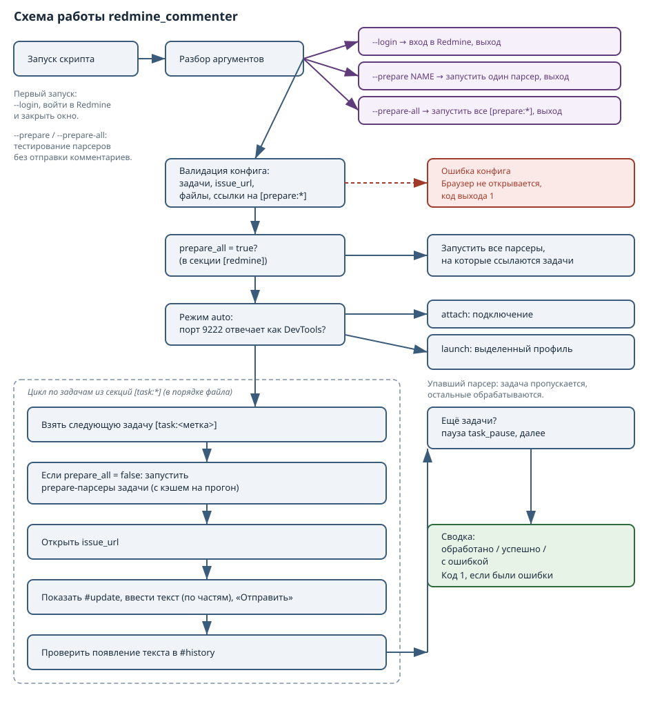

# redmine_commenter

Версия v1.13.

Скрипт добавляет комментарий к задаче Redmine через браузер, когда REST API и приём почты недоступны. Работает с выделенным профилем браузера: один раз войти — дальше без ручного вмешательства.

## Назначение и возможности

- Добавление комментария к одной задаче Redmine за запуск.
- Режим `auto` (по умолчанию): если браузер с портом отладки уже запущен — подключается, иначе запускает выделенный экземпляр с профилем скрипта.
- Выделенный профиль (`browser_profile/` в папке скрипта) не конфликтует с основным браузером.
- Автоматический поиск драйвера в папке скрипта: `chromedriver` (приоритет), затем `yandexdriver`. `driver_path` в конфиге — опционален.
- Одноразовая команда `--login` для входа в Redmine в выделенном профиле. Браузер отсоединён от терминала и не закрывается при завершении скрипта.
- Понимает стандартную структуру страницы Redmine: открывает скрытую форму `#update` перед вводом, жмёт кнопку именно в `#issue-form`, дожидается появления комментария в истории.
- Текст комментария берётся из отдельного файла (`comment_file`) или из `comment_text`. Файл удобен для многострочного текста с markdown-разметкой.

## Схема работы



## Файлы проекта

- [redmine_commenter.py](redmine_commenter.py) — основной скрипт.
- [config.ini](config.ini) — конфиг с параметрами запуска и браузера.
- [comment.txt](comment.txt) — пример текста комментария (используется, если задан `comment_file`).
- [readme.md](readme.md) — эта документация, включая историю изменений.
- [scheme.svg](scheme.svg) — схема работы.
- [rules-common.md](rules-common.md) — универсальные правила работы над проектами.
- [rules-project.md](rules-project.md) — правила и специфика этого проекта.

## Требования и установка

- Astra Linux с графической сессией.
- Python 3.10+.
- Браузер на базе Chromium (Chromium, Google Chrome или Яндекс.Браузер).
- Драйвер, **мажорная версия которого совпадает с версией браузера**.

### Установка Selenium в виртуальном окружении

Системный Python в Astra Linux защищён PEP 668. Используйте venv:

    sudo apt update
    sudo apt install python3-venv
    cd /path/to/redmine_commenter
    python3 -m venv .venv
    source .venv/bin/activate
    pip install selenium

### Выбор браузера и драйвера

**Ключевое правило:** мажорная версия драйвера должна совпадать с версией браузера.

Рекомендуемый вариант — **Chromium** (стабильная версия в Astra Linux) с официальным ChromeDriver той же версии. ChromeDriver всегда доступен под текущую версию Chromium, что исключает проблемы с несовпадением версий.

Альтернативы:
- **Google Chrome** + ChromeDriver соответствующей версии.
- **Яндекс.Браузер** + YandexDriver. Яндекс иногда задерживает выпуск драйверов под новые версии браузера, поэтому эта опция менее надёжна.

Скачать ChromeDriver можно на [Chrome for Testing](https://googlechromelabs.github.io/chrome-for-testing/). Если сайт недоступен (геоблокировка), используйте зеркало `https://registry.npmmirror.com/-/binary/chrome-for-testing/`.

### Установка драйвера

1. Определите версию браузера:
   ```bash
   chromium --version
   ```
2. Скачайте соответствующий ChromeDriver для `linux64`, распакуйте.
3. Сделайте файл исполняемым и положите в папку скрипта:
   ```bash
   chmod +x chromedriver
   mv chromedriver /path/to/redmine_commenter/
   ```
   Скрипт найдёт его автоматически. Параметр `driver_path` можно оставить пустым.

**Приоритет поиска драйвера:** `chromedriver` в папке скрипта → `yandexdriver` в папке скрипта → `driver_path` → Selenium Manager.

### Первоначальный вход в Redmine (одноразово)

В режиме `auto` скрипт использует выделенный профиль `browser_profile/`. В нём ещё нет сессии Redmine. Один раз выполните:

    python3 redmine_commenter.py --login

Откроется браузер с выделенным профилем. Войдите в Redmine и закройте окно браузера. После этого нажмите Enter в терминале (или просто закройте терминал — браузер отсоединён и не закроется сам).

**Почему браузер не закрывается при нажатии Enter.** Процесс запускается с `start_new_session=True`, то есть в отдельной сессии. Он не получает SIGHUP при завершении скрипта.

## Как задать текст комментария

Есть два взаимоисключающих способа. Приоритет — `comment_file`, если он непустой; иначе `comment_text`.

### Способ 1: файл `comment.txt` (рекомендуется)

Положите текст в файл `comment.txt` рядом со скриптом (UTF-8, без ограничений на содержимое), в конфиге укажите:

    [redmine]
    comment_file = comment.txt
    comment_text =

Файл может содержать пустые строки, markdown-списки, ссылки, спецсимволы — всё сохранится как есть. Относительный путь считается от папки скрипта; абсолютный тоже принимается.

### Способ 2: `comment_text` в конфиге

Для короткого текста без пустых строк:

    [redmine]
    comment_text = Однострочный комментарий

**Многострочный `comment_text` в INI.** Перевод строки делается продолжением строки с отступом (минимум один пробел или табуляция в начале каждой следующей строки):

    [redmine]
    comment_text = Первая строка
        Вторая строка
        Третья строка

Символ `\n` внутри значения **не** разворачивается в перевод строки — он попадёт в комментарий буквально как два символа. Пустую строку между абзацами в INI сохранить сложно (редакторы часто вычищают строки из одних пробелов), поэтому для текста с пустыми строками и списками надёжнее `comment_file`.

## Структура страницы Redmine и её особенности

Стандартная страница задачи Redmine (`/issues/<id>`) содержит поле `issue_notes`, но оно находится внутри блока `#update`, у которого по умолчанию `style="display:none"`. Форма показывается по клику на «Редактировать» — на этот клик навешан вызов `showAndScrollTo('update', 'issue_notes')`.

Скрипт учитывает это:

- вызывает `showAndScrollTo` (или при отсутствии этой функции — принудительно делает блок видимым) перед вводом;
- ищет кнопку «Отправить» строго внутри `#issue-form`, потому что на странице есть ещё кнопки с `name="commit"` (например, «Добавить» в форме новой связи);
- подтверждает результат появлением текста в блоке `#history`, а не только по факту клика.

## Таблица параметров конфига

| Секция | Параметр | Назначение | Значение по умолчанию |
|--------|----------|------------|----------------------|
| redmine | issue_url | URL страницы задачи | (обязательно) |
| redmine | comment_file | Путь к файлу с текстом комментария (приоритет над `comment_text`) | `comment.txt` |
| redmine | comment_text | Короткий текст комментария inline | (пусто) |
| redmine | timeout | Таймаут ожидания элементов, с | 15 |
| redmine | wait_after_submit | Пауза после отправки, с | 3 |
| redmine | notes_field_id | ID поля комментария | issue_notes |
| redmine | submit_button_name | Атрибут name кнопки отправки (часть селектора) | commit |
| browser | mode | Режим: `auto`, `attach` или `launch` | auto |
| browser | debugger_port | Порт отладки | 9222 |
| browser | browser_binary | Путь к браузеру | `/usr/bin/chromium` |
| browser | profile_dir | Каталог выделенного профиля | `./browser_profile` |
| browser | headless | Безголовый режим | False |
| browser | close_after | Закрывать браузер после работы | False |
| browser | driver_path | Путь к драйверу | (пусто) |
| browser | login_extra_args | Доп. аргументы Chromium при `--login` | (пусто) |

Из `comment_file` и `comment_text` должен быть задан хотя бы один. Если оба пусты — скрипт завершится с понятной ошибкой.

## Инструкции по получению токенов и паролей приложений

Не требуются: используется сессия в выделенном профиле браузера.

## Запуск по расписанию

Пример для cron (каждый день в 09:00). Используется полный путь к интерпретатору venv:

    0 9 * * * cd /home/username/redmine_commenter && /home/username/redmine_commenter/.venv/bin/python3 redmine_commenter.py --config config.ini >> /home/username/redmine_commenter/cron.log 2>&1

Для cron рекомендуется в `config.ini` установить `close_after = true` или `headless = true`, чтобы не оставлять открытое окно.

## Устранение неполадок

- **`element not interactable` на `#issue_notes`** — поле находится внутри скрытого блока `#update`. Скрипт v1.9 и новее открывает блок сам. Если ошибка осталась — проверьте в браузере, что на странице задачи есть `showAndScrollTo` (стандартная тема) или что `#update` можно показать принудительно.
- **Клик по кнопке «Отправить» уходит не туда** — на странице несколько `name="commit"`. Скрипт ограничивает селектор формой `#issue-form`.
- **`Не удалось прочитать comment_file`** — проверьте путь (относительный считается от папки скрипта), права на файл и кодировку UTF-8. Файл должен существовать до запуска скрипта.
- **`Файл comment_file пустой`** — текст в файле отсутствует или состоит из одних пробелов.
- **`В секции [redmine] должен быть задан либо 'comment_text', либо 'comment_file'`** — оба параметра пусты. Задайте хотя бы один.
- **Многострочный текст в `comment_text` превратился в одну строку** — используйте `comment_file` для текста с пустыми строками и разметкой. В INI пустые строки сохранить ненадёжно.
- **Браузер закрылся во время `--login`, вход не завершён** — начиная с v1.5 запуск идёт с `start_new_session=True`. Обновите скрипт.
- **`This version of ChromeDriver only supports Chrome version X. Current browser version is Y`** — мажорные версии драйвера и браузера не совпадают.
- **`cannot connect to chrome at 127.0.0.1:9222`** — браузер с портом отладки не запущен, и запуск нового экземпляра не удался.
- **`externally-managed-environment`** — не используйте `sudo pip`. Создайте venv.
- **`'chromedriver' executable needs to be in PATH`** — драйвер не найден в папке скрипта и не указан в `driver_path`.
- **`Поле комментария не найдено`** при первом запуске — выполните один раз `python3 redmine_commenter.py --login`.

## Безопасность

- Скрипт не хранит логины и пароли. Сессия Redmine сохраняется в выделенном профиле браузера.
- Профиль `browser_profile/` содержит cookie-сессию — не публикуйте его.
- Убедитесь, что порт `9222` доступен только локально.

## История изменений

### v1.13 — 2026-11-05

- Добавлен параметр `comment_file`: текст комментария берётся из файла (приоритет) или из `comment_text`.
- Новый раздел «Как задать текст комментария» с двумя способами и объяснением, почему для многострочного текста предпочтителен файл.
- В «Файлы проекта» добавлен `comment.txt` (пример текста).
- В таблицу параметров добавлен `comment_file`, переработаны записи для `comment_text`.
- В «Устранение неполадок» добавлены записи про `comment_file` и переписан пункт про многострочный текст.
- Уточнено, что `--config` нужен только для нестандартного имени конфига.

### v1.12 — 2026-11-05

- Добавлен раздел «Структура страницы Redmine и её особенности».
- В «Устранение неполадок» — записи про `element not interactable` и неверный выбор кнопки.

### v1.11 — 2026-11-05

- `run_login`: браузер запускается с `start_new_session=True`, не закрывается при завершении скрипта.

### v1.10 — 2026-11-05

- Сноска про многострочный `comment_text`.

### v1.9 — 2026-11-05

- Основной браузер — Chromium, поиск `chromedriver` → `yandexdriver`.

### v1.8 — 2026-11-05

- Совместимость версий драйвера и браузера.

### v1.7 — 2026-11-05

- Режим `auto`, выделенный профиль, команда `--login`.

### v1.6 — 2026-11-05

- Поиск драйвера в папке скрипта.

### v1.5 — 2026-11-05

- Инструкция по установке драйвера.

### v1.4 — 2026-11-05

- Установка Selenium через venv.

### v1.3 — 2026-11-05

- Файлы правил в «Файлы проекта».

### v1.2 — 2026-11-05

- Лицензия CC BY-SA 4.0, «Файлы проекта», «Схема работы».

### v1.1 — 2026-11-05

- Убраны `requirements.txt` и `changelog.md`.

### v1.0 — 2026-11-04

- Первая версия.

## Лицензия

Распространяется по лицензии [Creative Commons Attribution-ShareAlike 4.0](https://creativecommons.org/licenses/by-sa/4.0/deed.ru).